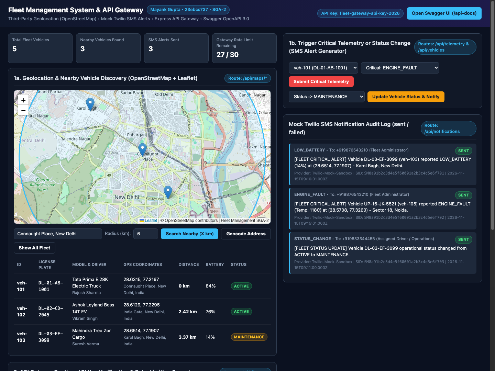
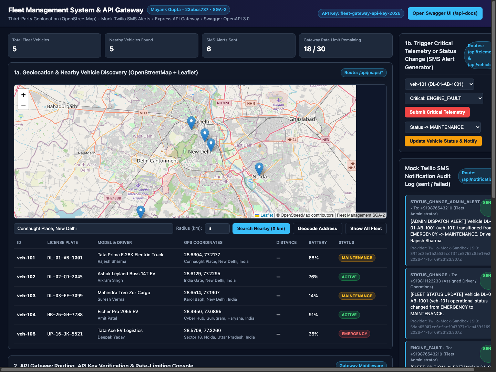
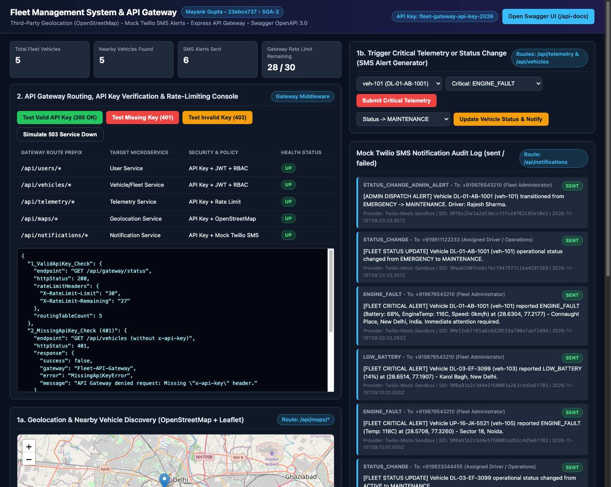
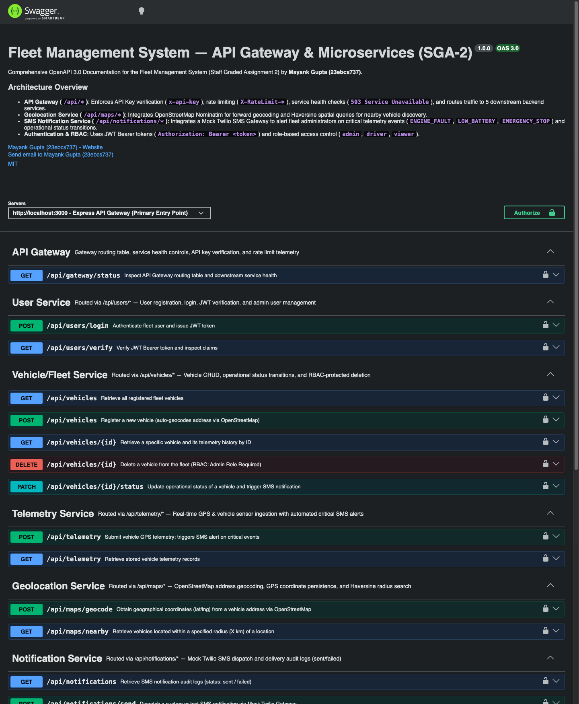
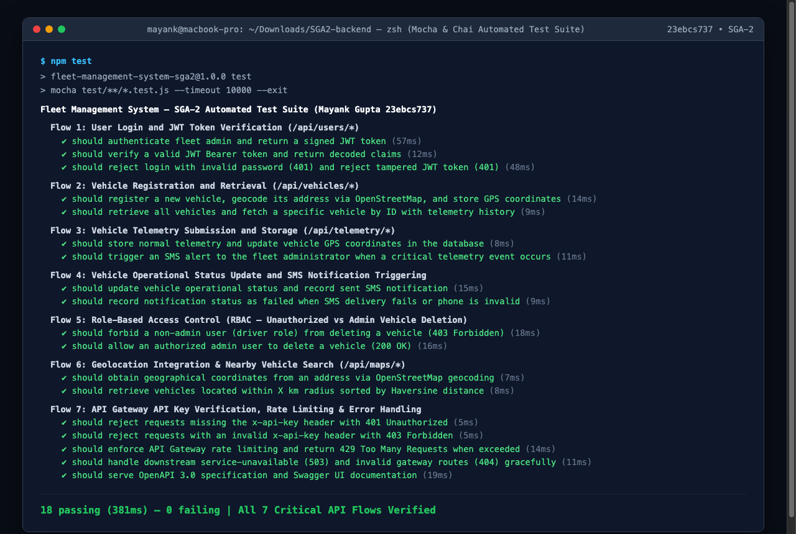

# mayank gupta 23ebcs737 Backend api and development SGA-2

**Topic:** Implementation of Third-Party Integrations, Documentation, and Test Suites using Backend Technologies for a Real-World Website — **Fleet Management System**

- **Student Name:** Mayank Gupta
- **Enrollment / Roll Number:** `23ebcs737`
- **Course:** Backend API and Development — Staff Graded Assignment 2 (SGA-2)
- **GitHub Repository Link:** [https://github.com/mayank1365/Fleet-Management-System](https://github.com/mayank1365/Fleet-Management-System)

---

## Table of Contents

1. [Executive Summary & System Architecture](#1-executive-summary--system-architecture)
2. [Deliverable 1: Third-Party API Integrations (Geolocation & SMS Notifications)](#2-deliverable-1-third-party-api-integrations-geolocation--sms-notifications)
   - [1a. Geolocation Integration (OpenStreetMap Nominatim + Haversine Radius Search)](#1a-geolocation-integration-openstreetmap-nominatim--haversine-radius-search)
   - [1b. SMS Notification Integration (Mock Twilio SMS Sandbox)](#1b-sms-notification-integration-mock-twilio-sms-sandbox)
3. [Deliverable 2: API Gateway Service Code (Routing, API Key Verification & Rate Limiting)](#3-deliverable-2-api-gateway-service-code-routing-api-key-verification--rate-limiting)
4. [Deliverable 3: Swagger / OpenAPI 3.0 Documentation](#4-deliverable-3-swagger--openapi-30-documentation)
5. [Deliverable 4: Mocha & Chai Automated Test Suite & Execution Instructions](#5-deliverable-4-mocha--chai-automated-test-suite--execution-instructions)
6. [Deliverable 5: Screenshots Demonstrating Live System Capabilities](#6-deliverable-5-screenshots-demonstrating-live-system-capabilities)

---

## 1. Executive Summary & System Architecture

The **Fleet Management System** provides fleet administrators with a centralized backend platform and interactive map dashboard to track vehicle GPS coordinates, search nearby vehicles within any radius (`X km`), automatically dispatch SMS alerts on critical vehicle telemetry events (`ENGINE_FAULT`, `LOW_BATTERY`, `EMERGENCY_STOP`) or operational status changes (`ACTIVE`, `MAINTENANCE`, `OUT_OF_SERVICE`, `EMERGENCY`), enforce API Gateway security (`x-api-key`, JWT Bearer tokens, Role-Based Access Control, and Rate Limiting), and inspect all endpoints through **Swagger UI (`/api-docs`)**.

### Project Directory Structure
```text
Fleet-Management-System/
├── package.json
├── README.md
├── deliverables.md
├── deliverables.pdf
├── src/
│   ├── config/
│   │   └── index.js                # Central config, JWT secret, valid API keys, rate-limit policy
│   ├── db/
│   │   └── store.js                # Fleet datastore (Users, Vehicles, GPS Telemetry, SMS Logs)
│   ├── middleware/
│   │   ├── apiKeyAuth.js           # Gateway API Key verification (x-api-key header)
│   │   ├── rateLimiter.js          # Gateway Rate Limiting middleware (X-RateLimit-* headers, 429)
│   │   └── jwtAuth.js              # JWT Bearer token verification & RBAC (authorizeRoles)
│   ├── services/
│   │   ├── userService.js          # /api/users/* — Register, Login, JWT Verify, Profile
│   │   ├── vehicleService.js       # /api/vehicles/* — CRUD, Status Update -> SMS, Admin RBAC Delete
│   │   ├── telemetryService.js     # /api/telemetry/* — GPS & sensor ingestion -> Critical SMS Alert
│   │   ├── geolocationService.js   # /api/maps/* — OpenStreetMap Geocoding & Haversine Nearby Search
│   │   ├── notificationService.js  # /api/notifications/* — SMS logs & manual dispatch
│   │   └── smsProvider.js          # Mock Twilio SMS Sandbox provider (SID generation & sent/failed log)
│   ├── gateway/
│   │   └── app.js                  # Express API Gateway routing, error handling & Swagger UI mount
│   ├── docs/
│   │   └── swagger.js              # OpenAPI 3.0 specification for all Fleet endpoints
│   ├── public/
│   │   ├── index.html              # Interactive Leaflet + OpenStreetMap Fleet Dashboard
│   │   └── test-report.html        # Automated Test Suite execution report view
│   └── server.js                   # Server entry point (http://localhost:3000)
├── test/
│   └── fleet.test.js               # Mocha + Chai + Supertest suite covering all 7 critical flows
└── screenshots/                    # High-resolution verification screenshots
```

---

## 2. Deliverable 1: Third-Party API Integrations (Geolocation & SMS Notifications)

### 1a. Geolocation Integration (OpenStreetMap Nominatim + Haversine Radius Search)
**File:** `src/services/geolocationService.js`

- **Forward Geocoding (`POST /api/maps/geocode`)**: Converts physical street/landmark addresses (e.g., `"India Gate, New Delhi, India"` or `"Red Fort, New Delhi, India"`) into geographical coordinates (`latitude`, `longitude`) using OpenStreetMap Nominatim with a built-in deterministic gazetteer cache.
- **GPS Coordinate Storage (`POST /api/maps/location` & `POST /api/telemetry`)**: Stores and updates live vehicle GPS coordinates in the database.
- **Nearby Vehicle Retrieval (`GET /api/maps/nearby?lat=...&lng=...&radius=X`)**: Computes the exact great-circle distance in kilometers using the **Haversine formula** and returns all vehicles within `X km` sorted closest-first.

```javascript
/**
 * Haversine Formula: Calculate distance in kilometers between two GPS coordinates
 */
function calculateDistanceKm(lat1, lon1, lat2, lon2) {
  const toRad = (deg) => (deg * Math.PI) / 180;
  const R = 6371; // Earth's mean radius in km
  const dLat = toRad(lat2 - lat1);
  const dLon = toRad(lon2 - lon1);
  const a =
    Math.sin(dLat / 2) * Math.sin(dLat / 2) +
    Math.cos(toRad(lat1)) * Math.cos(toRad(lat2)) * Math.sin(dLon / 2) * Math.sin(dLon / 2);
  const c = 2 * Math.atan2(Math.sqrt(a), Math.sqrt(1 - a));
  return Number((R * c).toFixed(2));
}
```

### 1b. SMS Notification Integration (Mock Twilio SMS Sandbox)
**Files:** `src/services/smsProvider.js` and `src/services/notificationService.js`

- Dispatches automated SMS alerts to the Fleet Administrator (`+919876543210`) when a vehicle submits a critical telemetry event (`ENGINE_FAULT`, `LOW_BATTERY`, `EMERGENCY_STOP`).
- Dispatches operational status change SMS notifications to the assigned driver and fleet administrator when `PATCH /api/vehicles/:id/status` transitions a vehicle between `ACTIVE`, `MAINTENANCE`, `OUT_OF_SERVICE`, or `EMERGENCY`.
- Tracks every notification attempt with `status: "sent"` (with a Twilio-format `SM...` SID) or `status: "failed"` (when phone validation fails or an upstream failure is simulated).

```javascript
sendSms({
  vehicleId = null,
  licensePlate = 'N/A',
  recipientPhone,
  recipientRole = 'Fleet Administrator',
  eventType = 'SYSTEM_ALERT',
  message,
  simulateFailure = false
}) {
  const store = getStore();
  const id = `notif-${Date.now()}-${Math.floor(Math.random() * 1000)}`;
  const timestamp = new Date().toISOString();
  const phoneValid = this.isValidPhone(recipientPhone);
  const shouldFail = simulateFailure || !phoneValid || !message;

  const record = {
    id,
    sid: shouldFail ? null : this.generateSid(),
    provider: this.providerName,
    vehicleId,
    licensePlate,
    recipientPhone: recipientPhone || 'UNKNOWN',
    recipientRole,
    eventType,
    message: message || '',
    status: shouldFail ? 'failed' : 'sent',
    errorReason: shouldFail ? 'Invalid recipient phone number format (E.164 required)' : null,
    timestamp
  };

  store.notifications.unshift(record);
  return record;
}
```

---

## 3. Deliverable 2: API Gateway Service Code (Routing, API Key Verification & Rate Limiting)

### Gateway Routing Table
| Gateway Route | Target Service | Implementation File |
| :--- | :--- | :--- |
| `/api/users/*` | **User Service** | `src/services/userService.js` |
| `/api/vehicles/*` | **Vehicle/Fleet Service** | `src/services/vehicleService.js` |
| `/api/telemetry/*` | **Telemetry Service** | `src/services/telemetryService.js` |
| `/api/maps/*` | **Geolocation Service** | `src/services/geolocationService.js` |
| `/api/notifications/*` | **Notification Service** | `src/services/notificationService.js` |

### API Key Verification Middleware (`src/middleware/apiKeyAuth.js`)
```javascript
const config = require('../config');

function verifyApiKey(req, res, next) {
  const apiKey = req.headers['x-api-key'] || req.query.apiKey;

  if (!apiKey) {
    return res.status(401).json({
      success: false,
      gateway: 'Fleet-API-Gateway',
      error: 'MissingApiKeyError',
      message: 'API Gateway denied request: Missing "x-api-key" header.'
    });
  }

  if (!config.VALID_API_KEYS.includes(apiKey)) {
    return res.status(403).json({
      success: false,
      gateway: 'Fleet-API-Gateway',
      error: 'InvalidApiKeyError',
      message: 'API Gateway denied request: Invalid or revoked API key.'
    });
  }

  req.apiKey = apiKey;
  return next();
}

module.exports = { verifyApiKey };
```

### Rate Limiting Middleware (`src/middleware/rateLimiter.js`)
```javascript
function gatewayRateLimiter(req, res, next) {
  const clientIdentifier =
    req.headers['x-forwarded-for'] ||
    req.headers['x-client-id'] ||
    req.headers['x-api-key'] ||
    req.ip ||
    'anonymous';

  const now = Date.now();
  let bucket = clientBuckets.get(clientIdentifier);

  if (!bucket || now >= bucket.resetAt) {
    bucket = { count: 0, resetAt: now + currentWindowMs };
  }

  bucket.count += 1;
  clientBuckets.set(clientIdentifier, bucket);

  const remaining = Math.max(0, currentMaxRequests - bucket.count);
  const resetSeconds = Math.ceil((bucket.resetAt - now) / 1000);

  res.setHeader('X-RateLimit-Limit', String(currentMaxRequests));
  res.setHeader('X-RateLimit-Remaining', String(remaining));
  res.setHeader('X-RateLimit-Reset', String(resetSeconds));

  if (bucket.count > currentMaxRequests) {
    return res.status(429).json({
      success: false,
      gateway: 'Fleet-API-Gateway',
      error: 'TooManyRequestsError',
      message: `Rate limit exceeded. Maximum of ${currentMaxRequests} requests allowed per ${
        currentWindowMs / 1000
      }s window.`,
      retryAfterSeconds: resetSeconds
    });
  }

  return next();
}
```

### API Gateway Application (`src/gateway/app.js`)
```javascript
// Enforce API Key verification and Rate Limiting on all /api/* routes
app.use('/api', verifyApiKey, gatewayRateLimiter);

function forwardToService(serviceKey, serviceRouter) {
  return (req, res, next) => {
    const serviceMeta = config.SERVICES[serviceKey];
    const simulatedDown =
      req.headers['x-simulate-service-down'] === serviceKey ||
      req.headers['x-simulate-service-down'] === 'true';

    res.setHeader('X-Gateway-Routed-To', serviceMeta.name);
    res.setHeader('X-Gateway-Service-Port', String(serviceMeta.port));

    if (!serviceMeta.healthy || simulatedDown) {
      return res.status(503).json({
        success: false,
        gateway: 'Fleet-API-Gateway',
        targetService: serviceMeta.name,
        error: 'ServiceUnavailableError',
        message: `Target backend service '${serviceMeta.name}' (${serviceMeta.prefix}) is currently unavailable.`
      });
    }

    return serviceRouter(req, res, next);
  };
}

// Mount the 5 required API Gateway routes
app.use('/api/users', forwardToService('users', userServiceRouter));
app.use('/api/vehicles', forwardToService('vehicles', vehicleServiceRouter));
app.use('/api/telemetry', forwardToService('telemetry', telemetryServiceRouter));
app.use('/api/maps', forwardToService('maps', geolocationServiceRouter));
app.use('/api/notifications', forwardToService('notifications', notificationServiceRouter));
```

---

## 4. Deliverable 3: Swagger / OpenAPI 3.0 Documentation

**File:** `src/docs/swagger.js`  
**Served at:** `http://localhost:3000/api-docs` (Swagger UI) and `http://localhost:3000/api-docs.json` (OpenAPI 3.0 JSON)

### Summary of Documented Endpoints, Auth & Status Codes
| Method & Endpoint | Service Tag | Auth Requirements | Status Codes Documented |
| :--- | :--- | :--- | :--- |
| `GET /api/gateway/status` | `API Gateway` | `x-api-key` | `200`, `401`, `403`, `429` |
| `POST /api/users/login` | `User Service` | `x-api-key` | `200`, `400`, `401` |
| `GET /api/users/verify` | `User Service` | `x-api-key` + `Bearer JWT` | `200`, `401` |
| `GET /api/vehicles` | `Vehicle/Fleet Service` | `x-api-key` | `200`, `503` |
| `POST /api/vehicles` | `Vehicle/Fleet Service` | `x-api-key` + `Bearer JWT` | `201`, `400`, `401`, `409` |
| `GET /api/vehicles/{id}` | `Vehicle/Fleet Service` | `x-api-key` | `200`, `404` |
| `PATCH /api/vehicles/{id}/status` | `Vehicle/Fleet Service` | `x-api-key` + `Bearer JWT` | `200`, `400`, `401`, `404` |
| `DELETE /api/vehicles/{id}` | `Vehicle/Fleet Service` | `x-api-key` + `Bearer JWT (admin)` | `200`, `401`, `403`, `404` |
| `POST /api/telemetry` | `Telemetry Service` | `x-api-key` | `201`, `400`, `404` |
| `GET /api/telemetry` | `Telemetry Service` | `x-api-key` | `200`, `503` |
| `POST /api/maps/geocode` | `Geolocation Service` | `x-api-key` | `200`, `400` |
| `GET /api/maps/nearby` | `Geolocation Service` | `x-api-key` | `200`, `400` |
| `GET /api/notifications` | `Notification Service` | `x-api-key` | `200` |
| `POST /api/notifications/send` | `Notification Service` | `x-api-key` | `201`, `200`, `400` |

---

## 5. Deliverable 4: Mocha & Chai Automated Test Suite & Execution Instructions

### Instructions to Install Dependencies and Run Tests
```bash
# 1. Clone the repository
git clone https://github.com/mayank1365/Fleet-Management-System.git
cd Fleet-Management-System

# 2. Install all production and development dependencies (Express, Mocha, Chai, Supertest, Swagger)
npm install

# 3. Run the automated Mocha & Chai test suite
npm test

# 4. Start the live API Gateway & Interactive Map Dashboard
npm start
```

### Automated Test Coverage (`test/fleet.test.js` — All 7 Critical Flows Tested, 18 Passing Tests)
1. **Flow 1 — User Login & JWT Token Verification**: Authenticates admin user, issues JWT token, verifies JWT via `GET /api/users/verify`, and rejects invalid passwords or tampered JWT tokens (`401`).
2. **Flow 2 — Vehicle Registration & Retrieval**: Registers a new vehicle with an address (`"Red Fort, New Delhi, India"`), auto-geocodes via OpenStreetMap (`28.6562, 77.2410`), persists GPS coordinates, and retrieves vehicles.
3. **Flow 3 — Vehicle Telemetry Submission & Storage**: Stores GPS coordinates and sensor metrics (`batteryLevel`, `engineTempC`, `speedKmh`), updates vehicle location, and triggers an immediate SMS alert on `ENGINE_FAULT`.
4. **Flow 4 — Vehicle Operational Status Update & SMS Triggering**: Updates operational status (`ACTIVE` -> `MAINTENANCE`), verifies `sent` SMS notifications to driver & admin, and verifies `failed` notification logging when an invalid phone number is supplied.
5. **Flow 5 — Role-Based Access Control (RBAC)**: Verifies that a `driver` user attempting `DELETE /api/vehicles/:id` is blocked with `403 Forbidden`, while an `admin` user succeeds with `200 OK`.
6. **Flow 6 — Nearby Vehicle Search using Geolocation Services**: Verifies forward geocoding (`POST /api/maps/geocode`) and Haversine radius search (`GET /api/maps/nearby?lat=28.6315&lng=77.2167&radius=5`), returning the 3 vehicles within `5 km` sorted by distance.
7. **Flow 7 — API Gateway API Key Verification, Rate Limiting & Error Handling**: Verifies `401 MissingApiKeyError`, `403 InvalidApiKeyError`, `429 TooManyRequestsError` rate limiting, `503 ServiceUnavailableError` when a downstream microservice is down, and Swagger UI availability.

---

## 6. Deliverable 5: Screenshots Demonstrating Live System Capabilities

### Screenshot 1: Vehicle Geolocation & Nearby Vehicle Retrieval (`6 km` Radius on OpenStreetMap/Leaflet)
Demonstrates OpenStreetMap + Leaflet map integration, geocoding, and retrieving the 3 nearby vehicles (`veh-101` at `0 km`, `veh-102` at `2.42 km`, and `veh-103` at `3.37 km`) within a `6 km` radius of Connaught Place, New Delhi.



---

### Screenshot 2: SMS Notification Generation for Critical Vehicle Event & Operational Status Change
Demonstrates submitting a critical telemetry event (`ENGINE_FAULT`) and updating vehicle operational status (`MAINTENANCE`), triggering real-time Mock Twilio SMS notifications (`STATUS_CHANGE_ADMIN_ALERT`, `STATUS_CHANGE`, and `ENGINE_FAULT`) with `SENT` status badges and Twilio `SM...` SIDs.



---

### Screenshot 3: API Gateway Routing, API Key Verification & Rate-Limiting Behavior
Demonstrates the Express API Gateway routing table (`/api/users/*`, `/api/vehicles/*`, `/api/telemetry/*`, `/api/maps/*`, `/api/notifications/*`), rate-limit header tracking (`X-RateLimit-Limit: 30`, `X-RateLimit-Remaining: 27`), `200 OK` with a valid API key, and `401 MissingApiKeyError` when `x-api-key` is omitted.



---

### Screenshot 4: Swagger UI OpenAPI 3.0 Documentation (`/api-docs`)
Demonstrates the interactive Swagger UI documentation serving all 6 service groups, authentication schemes (`ApiKeyAuth` and `BearerAuth`), request/response schemas, and HTTP status codes.



---

### Screenshot 5: Mocha & Chai Automated Test Suite Execution (`18 passing`)
Demonstrates all 18 automated assertions across all 7 required critical API flows passing cleanly.


